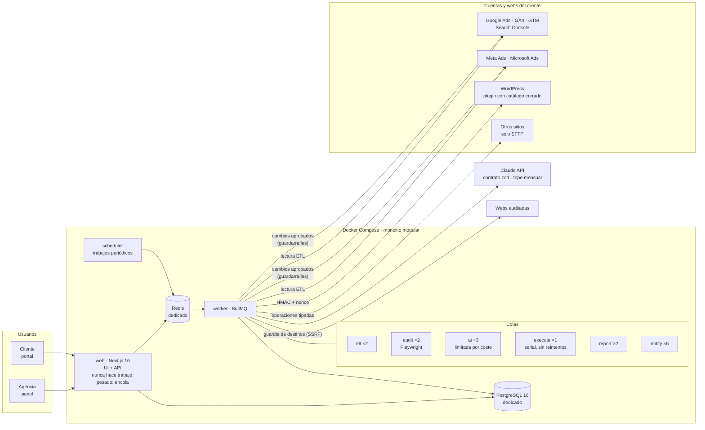
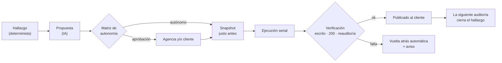

# Datafaro · operación con IA para agencias de marketing digital

**Web:** https://datafaro.es

> **Proyecto propio.** Plataforma que conecta las cuentas de publicidad y analítica de los clientes de una agencia, audita sus webs, detecta problemas, **propone y aplica correcciones con aprobación** y comprueba que desaparecen en la siguiente auditoría. El código es privado. Aquí están el problema, la arquitectura, las decisiones y [fragmentos del código real](snippets/), además del [detalle de seguridad](docs/seguridad.md).

## El problema

Una agencia pequeña gestiona para cada cliente Google Ads, Analytics, Tag Manager, Search Console, a veces Meta y Microsoft Ads, y su web. En la práctica:

- **Los problemas se descubren tarde**, a menudo cuando llama el cliente: un tag de conversión que dejó de disparar, una campaña que gasta sin convertir, una web con errores que nadie vio.
- **Revisarlo todo a mano es imposible**, así que se revisa poco y de forma distinta cada vez.
- **Cada corrección es una tarea manual**: entrar en el WordPress del cliente, cambiar una meta, poner una cabecera, pausar una palabra clave…
- **Los informes se hacen a mano** y no muestran de forma comparable si las cosas mejoran.
- Y **dejar que una IA toque las webs y el dinero de los clientes** sin control es inaceptable.

## La solución

Un solo producto construido sobre una idea: **todo es una ejecución**. Una auditoría, un análisis de campañas, aplicar doce correcciones o generar el informe mensual comparten la misma anatomía:

```
disparador → contexto → ejecutor (motor determinista · IA · persona) → entradas → salida → coste → estado → visibilidad
```

Añadir un módulo, sea SEO, Meta Ads o Microsoft Ads, consiste en registrar un ejecutor más.

Y una regla que define la arquitectura:

| Capa | Hace | Ejemplo |
|---|---|---|
| **Motor determinista** | Recoge datos y detecta hechos | «El contenedor de Tag Manager tiene 3 tags sin activador» |
| **IA (Claude)** | Prioriza, explica, redacta y propone | «De estos hallazgos, estos 5 cuestan conversiones. Este es el plan» |
| **Política + persona** | Autoriza | Según el nivel de servicio, se aplica solo o espera un visto bueno |

Las comprobaciones son deterministas porque un modelo haciéndolas sería caro, lento, no reproducible y a veces se inventaría hallazgos. Además, así los hallazgos **son comparables entre auditorías**: «en enero tenías 34 problemas; hoy tienes 6».

**Qué hace:**
- **Conecta** Google Ads, GA4, Tag Manager, Search Console, Meta Ads y Microsoft Ads (OAuth y consentimiento) y la web del cliente (plugin de WordPress o SFTP).
- **Audita** con un navegador real (Playwright): rastreo, rendimiento, seguridad, medición, SEO, anuncios y contenido. El catálogo documenta 75 comprobaciones, con nota global y por categoría.
- **Propone** correcciones priorizadas por la IA, campañas nuevas (que nacen en pausa) y **páginas nuevas** para los términos por los que el cliente no aparece nunca.
- **Aplica** los cambios con una matriz de autonomía, snapshot, verificación y vuelta atrás automática.
- **Informa y vigila:** informes con marca propia, portal del cliente, alertas y registro de quién hizo qué, cuándo y por qué.

## Arquitectura



**El ciclo de un cambio:**



## Stack

Versiones según el `package.json` y los `Dockerfile` del proyecto.

| Capa | Tecnología | Versión |
|---|---|---|
| Runtime | Node.js | 24 |
| Lenguaje | TypeScript | 5.9 |
| Web | Next.js (App Router) y React | 16.3 / 19.2 |
| Datos | PostgreSQL con Drizzle ORM (y SQL directo donde conviene) | 16 / 0.45 |
| Colas | Redis con BullMQ e ioredis | 6.2 / 6.0 |
| IA | SDK de Anthropic (Claude) con contratos zod | 0.120 / zod 4.4 |
| Auditoría y PDF | Playwright | 1.62 |
| Conexión SFTP | ssh2 | 1.17 |
| Autenticación | Sesión propia, argon2, TOTP | — |
| Plugin | PHP para WordPress | — |
| Logs | pino | 10.3 |
| Pruebas | Vitest | 4.1 |
| Despliegue | Docker Compose, imágenes construidas en CI | — |

## Decisiones técnicas

### Arquitectura aburrida, a propósito
Lo construye y opera **una sola persona con Claude Code**, así que no hay microservicios ni piezas exóticas. Es un **monolito modular**: un repositorio, un despliegue y módulos con fronteras claras. PostgreSQL y Redis están dedicados al stack. Web, worker y scheduler van por separado: la web nunca hace trabajo pesado y se puede reiniciar uno sin tocar el otro.

### Colas con concurrencia pensada una a una
- Las auditorías usan Playwright, que consume mucha memoria, así que su concurrencia es baja.
- La IA se limita por coste, no por CPU.
- **La ejecución de cambios es serial y no se reintenta:** dos ejecuciones a la vez sobre el mismo sitio es la receta del desastre, y un cambio a medio aplicar lo revisa una persona.

### La IA propone y una política decide
Una **matriz de autonomía** decide qué se aplica solo y qué necesita aprobación de la agencia o del cliente, según el nivel de servicio y según si el cambio toca dinero o conversiones.
- Hay un **suelo de seguridad** que no se configura.
- Crear o activar campañas y publicar páginas nuevas lo hace **siempre una persona**, y todo lo que va por SSH pasa por aprobación.
- En una propuesta **manda el cambio más restrictivo**, y la política se vuelve a evaluar justo antes de ejecutar.

→ [snippets/politica-autonomia.ts](snippets/politica-autonomia.ts)

### Verificar no es «no ha dado error»
Tras aplicar un cambio se comprueba, de lo más barato a lo más caro:
1. que quedó escrito;
2. que la portada responde 200;
3. que la reauditoría no ve más hallazgos críticos.

Si falla cualquiera, **se deshace todo**, aunque el cambio se aplicara sin error. El snapshot se toma justo antes de aplicar, nunca antes.

### Catálogos cerrados en lugar de código generado
- **En WordPress**, el plugin solo acepta operaciones tipadas (`set_meta_title`, `set_redirect`…), con peticiones firmadas con HMAC, nonce de un solo uso, límite por minuto y autobloqueo.
- **En otros sitios**, el modelo no genera comandos: genera `{ operation: "replace_in_file", … }` y el ejecutor, que solo habla SFTP, lo valida contra listas blanca y negra y aplica exactamente las ocurrencias declaradas.

→ [snippets/rutas-ssh.ts](snippets/rutas-ssh.ts) · [docs/seguridad.md](docs/seguridad.md)

### Una sola puerta a la IA, con contrato y con tope
Todas las tareas de IA (priorizar hallazgos, proponer correcciones, analizar campañas, redactar el informe, crear campañas y páginas) pasan por una única función:
- **exige una salida que valide contra un esquema zod**, reintenta una vez y, si no, falla;
- **registra el coste** de cada llamada en el momento;
- **se para al llegar al tope mensual** de la agencia, con aviso al 80 %.

→ [snippets/puerta-ia.ts](snippets/puerta-ia.ts)

### Una nota que no cambia si cambia el catálogo
La nota es la proporción del problema **potencial** que evita el sitio, calculada sobre lo que de verdad se evaluó, no restando sobre 100. Se tomó esta decisión cuando ampliar el catálogo de 22 a 45 comprobaciones hundió la nota de un sitio que no había cambiado. Los fallos en páginas pesan según la proporción de páginas afectadas, y una categoría sin nada evaluado no aparece.

→ [snippets/puntuacion.ts](snippets/puntuacion.ts)

### El auditor no puede usarse para atacar al servidor
El motor sigue enlaces de webs ajenas desde dentro del servidor. Un **guardia de destinos** resuelve cada nombre, rechaza direcciones internas y sigue las redirecciones a mano, validando cada salto.

→ [snippets/guardia-de-destinos.ts](snippets/guardia-de-destinos.ts)

### Pagar es el parche; escribir la página es la solución
Cuando la auditoría de contenido detecta términos por los que el cliente **no aparece nunca**, el sistema no se limita a proponer una campaña que los pague. Propone **la página que falta**, con título, estructura, texto y metadatos:
- una persona la revisa siempre, en todos los niveles de servicio;
- se publica primero como **borrador** en el WordPress del cliente;
- se propone desde dónde enlazarla;
- se verifica con una nueva auditoría.

## Cómo se construyó

Con **Claude Code** y la documentación por delante:

- **Diez documentos de diseño antes del código**, unas 4.400 líneas: visión y alcance, modelo de datos, arquitectura, seguridad y accesos, sistema de diseño, hoja de ruta, catálogo de comprobaciones, presencia en buscadores, blog e identidad visual. Además, un `CLAUDE.md` que dice qué documento leer antes de tocar cada módulo, y un `ESTADO.md` que se actualiza en cada sesión.
- **Fases en las que el riesgo crece poco a poco:**
  - **0 · Cimientos.**
  - **1 · Solo lectura:** aporta valor y no puede romper nada.
  - **2 · La IA opina:** genera, no aplica.
  - **3 · La IA ejecuta, con correa.**
  - **4 · Expansión.**
  - **5 · La web que falta.**
  
  Cada fase tiene un criterio de terminado comprobable y su **script de verificación**.
- **Reglas del proyecto:**
  - una fase a la vez;
  - especificación antes del código de cada módulo;
  - la documentación se actualiza en el mismo cambio que el código;
  - ningún atajo en aislamiento, snapshots ni registro de auditoría.
- **Probado contra servicios reales, no solo contra simulaciones.** El plugin se verificó contra un WordPress real, y así salieron fallos que ninguna prueba unitaria habría visto, como la doble llamada al `permission_callback`.
- **Ritmo:** los 116 commits del repositorio van del **21 al 28 de agosto de 2026**. En esa semana se construyeron las fases de la hoja de ruta. Después siguieron los ajustes de estilo y de despliegue.

## Estado actual

- **En producción:** la aplicación (panel de agencia, portal del cliente y trabajos de fondo) y la web pública.
- **Fases 0 a 5 construidas.** El criterio de la fase 3 se cumplió **sobre datos reales**: un hallazgo detectado por el sistema se propuso, se aplicó, se verificó y desapareció de la siguiente auditoría sin intervención manual. Por ejemplo, cinco cabeceras de seguridad de un mismo sitio.
- **Para estrenar tres integraciones** faltan permisos de terceros. No queda nada por construir de la hoja de ruta.
- **Repositorio:** unas 43.000 líneas de TypeScript en `src/`, un plugin de WordPress en PHP (unas 1.700 líneas), 63 ficheros de pruebas y scripts de verificación por fase.
## Lo que he aprendido

- **Un prompt no es una defensa.** La seguridad está en lo que el sistema no puede hacer: catálogos cerrados, SFTP sin shell, listas blancas y rutas resueltas. No en pedirle al modelo que no lo haga.
- **Lo determinista, determinista.** La IA aporta valor al priorizar y redactar sobre hechos comprobados, no detectando los hechos.
- **Verificar es comprobar el efecto, no la ausencia de error.** Un cambio que se aplica bien pero no mejora nada, o rompe la portada, se deshace.
- **Autonomía graduada.** Lo que decide si algo se aplica solo es una tabla que cualquiera puede leer, con un suelo que no se puede bajar.
- **Probar contra el servicio real encuentra lo que el simulado no tiene.** WordPress llamando dos veces a la misma comprobación de permisos no sale en ningún mock.
- **Una métrica tiene que significar lo mismo mañana.** Si ampliar el catálogo cambia la nota de un sitio que no ha cambiado, la nota no vale para comparar.
- **Documentar primero permite construir rápido con IA.** Con la especificación de cada módulo escrita, Claude Code produce código coherente en vez de improvisar.
